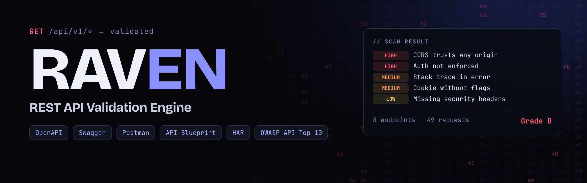
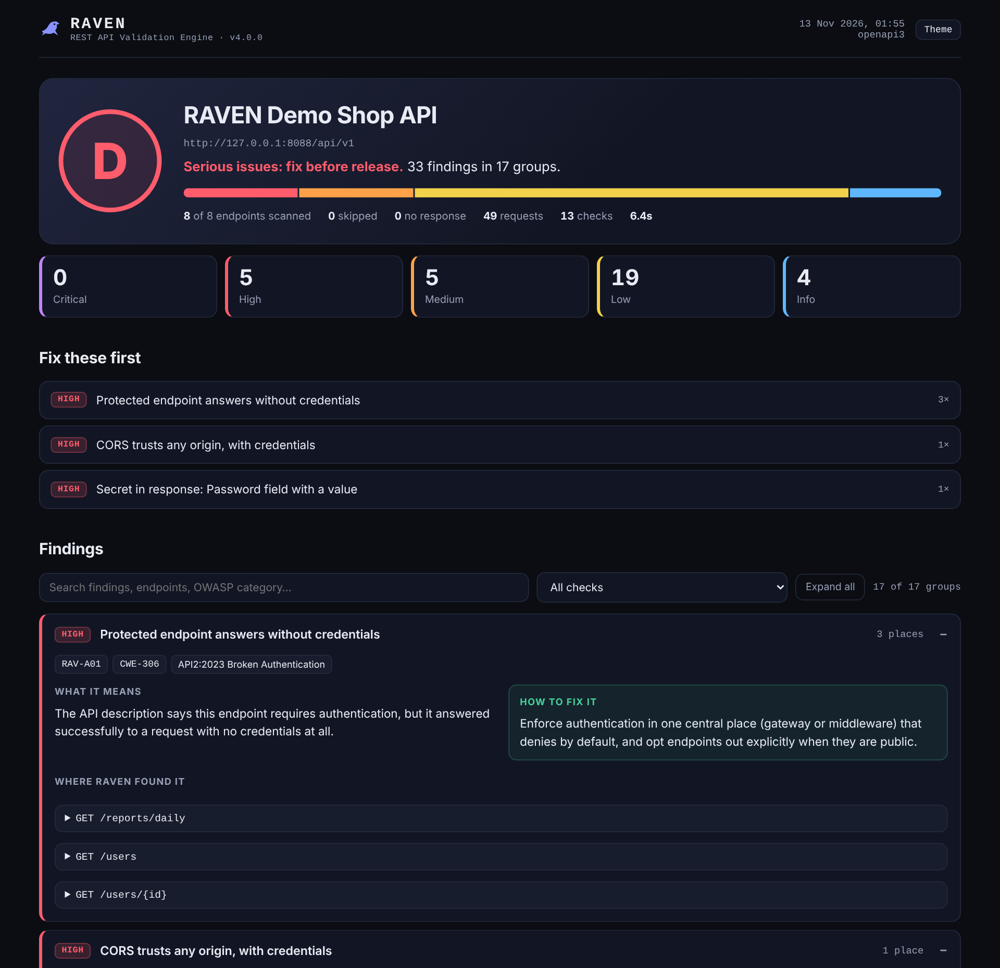
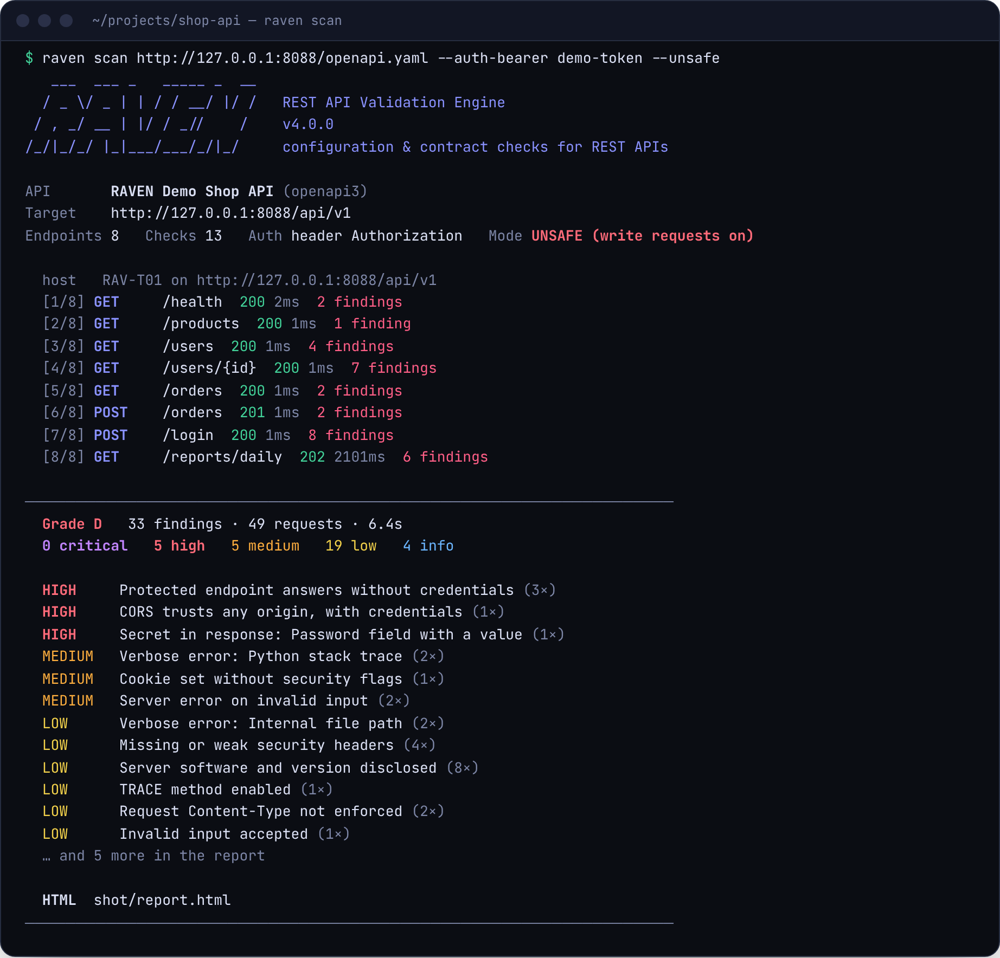
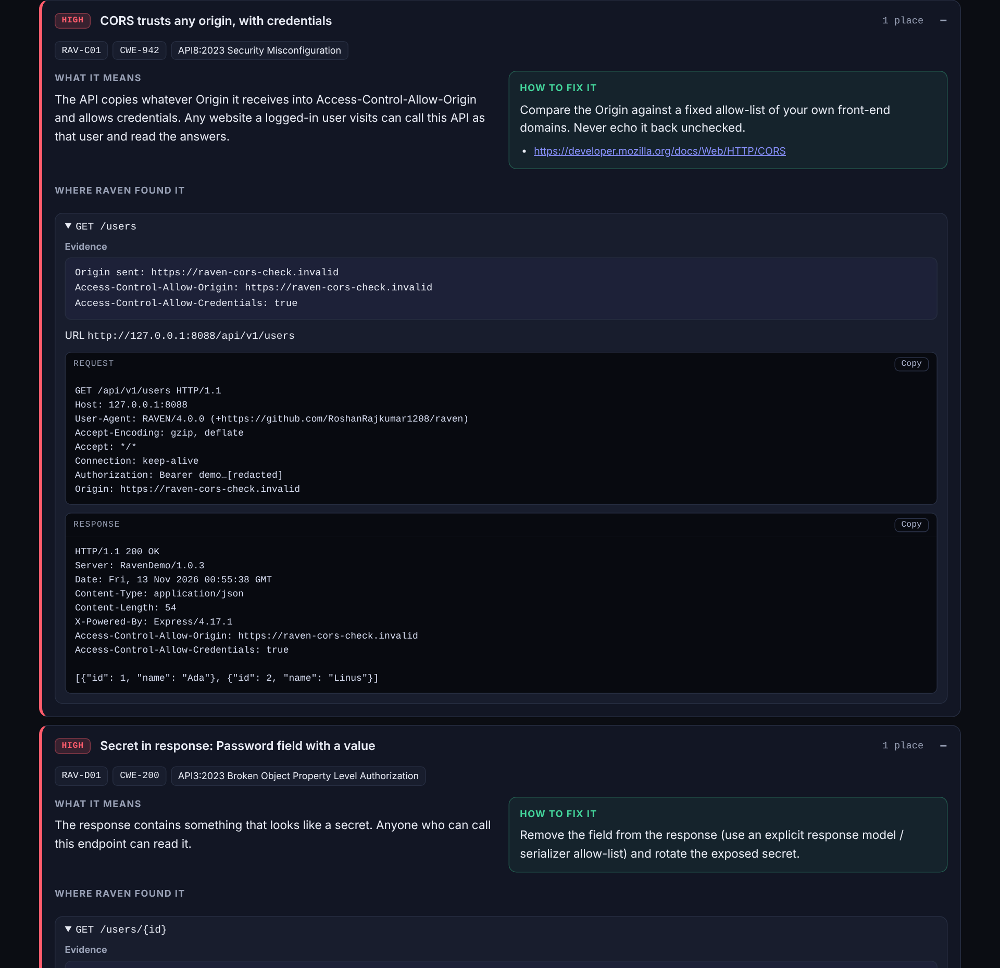
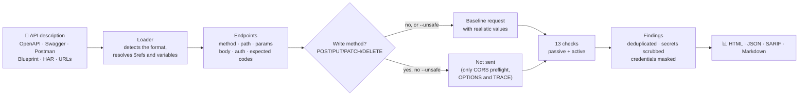

<p align="center">
  
</p>

<p align="center">
  <a href="https://github.com/RoshanRajkumar1208/raven/actions/workflows/tests.yml"></a>
  
  
  
  
  
</p>

<h3 align="center">Point it at your API description. Get a clear security report.</h3>

<p align="center">
RAVEN reads your OpenAPI, Swagger, Postman, API Blueprint or HAR file, sends real requests to every endpoint, and tells you<br>
<b>where the API is misconfigured</b> and <b>where it does not do what its own documentation promises</b>, with the fix for each.
</p>

<p align="center">
  <a href="#-try-it-in-60-seconds">Quick start</a> ·
  <a href="#-what-raven-finds">What it finds</a> ·
  <a href="#-what-you-can-feed-it">Inputs</a> ·
  <a href="#%EF%B8%8F-all-options">Options</a> ·
  <a href="#-reports-and-cicd">Reports & CI</a> ·
  <a href="#-limits">Limits</a>
</p>

<p align="center">
  
</p>

---

## ✨ Why RAVEN

| | |
|---|---|
| 📄 **Reads what you already have** | OpenAPI 3.0/3.1, Swagger 2.0, Postman collections (with environments), API Blueprint, HAR recordings, URL lists, or a single URL. The format is detected automatically. |
| 🛡️ **Safe by default** | Only read requests are sent (GET, HEAD, OPTIONS, TRACE). Requests that could create or change data are sent only when you add `--unsafe`. |
| 🎯 **Findings you can act on** | Every finding has a severity, the evidence (exact request and response), CWE and OWASP API Top 10 references, and a plain-English fix. |
| 🔐 **Careful with secrets** | Tokens, API keys and cookies are masked in every report, even when a server echoes them back. Secrets found in responses are never copied into the report. |
| ⚙️ **Built for pipelines** | SARIF for GitHub code scanning, JSON for your tooling, Markdown for job summaries, and `--fail-on high` to block a release. |
| 🪶 **Light** | Pure Python, two dependencies (`requests`, `PyYAML`). Runs on Windows, macOS and Linux. |

---

## 🚀 Try it in 60 seconds

RAVEN ships with a small **practice API** full of deliberate mistakes, so you can see real findings without touching any real system.

```bash
# 1. Install (needs Python 3.9 or newer, and Git)
pip install git+https://github.com/RoshanRajkumar1208/raven.git

# 2. Start the practice API (keep this terminal open)
raven demo

# 3. In a second terminal: scan it
raven scan http://127.0.0.1:8088/openapi.yaml --auth-bearer demo-token --open
```

The report opens in your browser. You should see **grade D** with findings such as an open CORS policy, an endpoint that skips its authentication check, a leaked password hash and a stack trace in an error.

<p align="center"></p>

> [!TIP]
> **No Git?** Click **Code → Download ZIP** on this page, unzip it, open a terminal in that folder and run `pip install .`
>
> **Windows:** if `raven` is not found after installing, use `python -m raven_api` instead of `raven`, for example `python -m raven_api demo`.

---

## 🔎 What RAVEN finds

13 checks. Run `raven checks` to see them in your terminal.

| ID | Check | What it finds | Typical severity | OWASP API 2023 |
|---|---|---|---|---|
| `RAV-T01` | 🔒 TLS and HTTPS | Untrusted or expiring certificates, TLS 1.0/1.1, API served over plain HTTP or answering on `http://` without redirecting | Low – High | API8 |
| `RAV-H01` | 🧱 Security headers | Missing or weak `Strict-Transport-Security`, missing `X-Content-Type-Options: nosniff`, cacheable authenticated responses, no framing protection on HTML | Low – Medium | API8 |
| `RAV-H02` | 🏷️ Technology disclosure | `Server`, `X-Powered-By`, `X-AspNet-Version`… revealing software and versions | Low | API8 |
| `RAV-H03` | 🍪 Cookie flags | Cookies without `Secure`, `HttpOnly` or `SameSite` | Low – Medium | API8 |
| `RAV-C01` | 🌐 CORS policy | API trusts any origin (with or without credentials), allows `null`, invalid wildcard + credentials | Medium – High | API8 |
| `RAV-M01` | 🚦 HTTP methods | `TRACE` enabled, methods advertised in `Allow` but not documented | Info – Low | API8, API9 |
| `RAV-A01` | 🔑 Authentication enforcement | Endpoints documented as protected that answer without any credentials | High | API2 |
| `RAV-V01` | ✅ Input validation | Values that break the documented types, enums, min/max, lengths, formats or required fields causing **5xx errors** or being **accepted**; JSON bodies accepted as `text/plain` | Low – Medium | API8 |
| `RAV-V02` | 📜 Response contract | Undocumented status codes, missing `Content-Type`, JSON served as `text/html` | Info – Low | API9 |
| `RAV-D01` | 🗝️ Sensitive data | Private keys, cloud/service API keys, password fields with values in responses | High – Critical | API3 |
| `RAV-E01` | 💥 Verbose errors | Stack traces (Python, Java, .NET, Node.js, PHP), database errors, debug pages, internal file paths | Low – Medium | API8 |
| `RAV-P01` | 🐢 Slow responses | Endpoints slower than `--slow-ms` | Info | API4 |
| `RAV-R01` | ⏱️ Rate-limit signals | No `RateLimit-*` / `Retry-After` headers on any response | Info | API4 |

**Passive** checks only read the normal response. **Active** checks send a few extra, harmless requests: a different `Origin`, an `OPTIONS` or `TRACE`, the same request without credentials, or values that break the documented schema. `--profile quick` runs only the passive checks plus the TLS check: about one request per endpoint.

### How a finding is graded

| Grade | Meaning |
|:---:|---|
| **A** | No medium, high or critical findings |
| **B** | Medium findings only |
| **C** | One high finding, or more than three medium |
| **D** | Two or more high findings |
| **F** | At least one critical finding |

---

## 📥 What you can feed it

| Input | Example | Notes |
|---|---|---|
| **OpenAPI 3.0 / 3.1** (YAML or JSON) | `raven scan openapi.yaml` | Uses servers, parameters, request bodies, examples, `security` and response codes. Follows local `$ref`s, including recursive ones. |
| **Swagger 2.0** | `raven scan swagger.json` | `host` + `basePath`, `body` and `formData` parameters, `security`. |
| **Postman collection** v2.0 / v2.1 | `raven scan api.postman_collection.json --postman-env staging.postman_environment.json` | Folders, inherited auth (bearer, API key, basic), `{{variables}}`, `:path` variables, raw/urlencoded/form-data/GraphQL bodies. Set variables with `--var name=value`. |
| **API Blueprint** (`.apib`) | `raven scan api.apib` | `HOST`, resources, URI templates (`{?query}`), `+ Parameters`, request headers and bodies, response codes. |
| **HAR** (browser DevTools, Burp, ZAP) | `raven scan traffic.har` | Record yourself clicking through the app, export as HAR, scan. Static files and HTML pages are skipped. |
| **URL list** (`.txt`) | `raven scan urls.txt` | One `METHOD URL` or `URL` per line, `#` for comments. |
| **A single URL** | `raven scan https://api.example.com/v1/users` | A URL that points to any of the formats above is downloaded and read as that format. |

All of these are in [`examples/`](examples/), written for the practice API.

> [!NOTE]
> Only OpenAPI and Swagger describe types and limits, so `RAV-V01` (input validation) is most useful with those. Postman, HAR and URL lists still get every other check.

---

## 🧭 Common recipes

```bash
# Scan a staging copy of your API instead of the server written in the spec
raven scan openapi.yaml --target https://staging.example.com --auth-bearer "$TOKEN"

# Include POST/PUT/PATCH/DELETE endpoints (TEST SYSTEMS ONLY: they can change data)
raven scan openapi.yaml --target https://staging.example.com --auth-bearer "$TOKEN" --unsafe

# Only the user endpoints, only GET
raven scan openapi.yaml --include "/users*" --methods GET

# Fast, passive health check of headers, cookies, TLS and error pages
raven scan openapi.yaml --profile quick

# Run just two checks
raven scan openapi.yaml --only RAV-C01,RAV-H01

# Watch every request in Burp Suite
raven scan openapi.yaml --proxy http://127.0.0.1:8080 --insecure

# Be gentle with a shared environment
raven scan openapi.yaml --delay 200 --max-requests 300

# See what RAVEN will test, without sending anything
raven list openapi.yaml
```

---

## ⚙️ All options

<details open>
<summary><b>Input</b></summary>

| Option | What it does |
|---|---|
| `SOURCE` | File or URL: OpenAPI, Swagger, Postman, API Blueprint, HAR, URL list, or one endpoint URL |
| `-t, --target URL` | Scan this base URL instead of the server in the description. If it has no path, the description's base path is kept (`--target https://staging.example.com` on `https://api.example.com/v1` scans `https://staging.example.com/v1`) |
| `--input-type TYPE` | Force the format: `openapi`, `swagger`, `postman`, `blueprint`, `har`, `urls` (default: detect) |
| `--var NAME=VALUE` | Postman variable (repeatable) |
| `--postman-env FILE` | Postman environment export |
| `--values FILE` | Values to use for parameters, e.g. `id: 42` or `query.limit: 5` ([example](examples/values.yaml)) |
| `--include PATTERN` / `--exclude PATTERN` | Only / skip paths matching a wildcard pattern (repeatable) |
| `--methods LIST` | Only these methods, e.g. `GET,POST` |
</details>

<details open>
<summary><b>Authentication</b> (all masked in reports)</summary>

| Option | What it does |
|---|---|
| `--auth-bearer TOKEN` | `Authorization: Bearer TOKEN` |
| `--auth-basic USER:PASS` | HTTP Basic |
| `--api-key NAME=VALUE` | API key in a header, e.g. `X-API-Key=abc123` |
| `--api-key-query NAME=VALUE` | API key in the query string |
| `--cookie "a=b; c=d"` | Cookies |
| `--token-file FILE` | Log in automatically and refresh the token during long scans (OAuth2 client credentials or any login endpoint). Secrets come from environment variables. [Example](examples/token-file.yaml) |
| `-H "Name: value"` | Extra header on every request (repeatable) |

Credentials given on the command line replace credentials in the same header that a Postman collection or HAR file already contains.
</details>

<details open>
<summary><b>What to run</b></summary>

| Option | What it does |
|---|---|
| `--profile quick\|standard` | `quick`: passive checks (+ TLS), about one request per endpoint. `standard` (default): everything |
| `--only IDS` / `--skip IDS` | Choose checks by ID, e.g. `RAV-H01,RAV-C01` |
| `--unsafe` | Also send POST/PUT/PATCH/DELETE. Asks for confirmation if the target is not your own machine (`--yes` to skip) |
| `--slow-ms MS` | Slow-response threshold (default 2000) |
| `--max-cases N` | Invalid-input requests per parameter (default 4) |
</details>

<details open>
<summary><b>Network</b></summary>

| Option | What it does |
|---|---|
| `--timeout SEC` | Per-request timeout (default 15) |
| `--delay MS` | Pause between requests |
| `--max-requests N` | Hard limit on requests (default 5000). The report is still written |
| `--proxy URL` | Route traffic through Burp Suite, ZAP or a corporate proxy |
| `--insecure` | Skip TLS certificate verification |
| `--user-agent UA` | Custom User-Agent |
</details>

<details open>
<summary><b>Output</b></summary>

| Option | What it does |
|---|---|
| `-o, --output DIR` | Report folder (default `raven-report-<date-time>`) |
| `--format LIST` | `html`, `json`, `sarif`, `md` or `all` (default `html,json`) |
| `--fail-on SEVERITY` | Exit code 1 if anything at this severity or worse is found |
| `--open` | Open the HTML report when done |
| `--no-redact` | Show credentials in reports (not recommended) |
| `-q, --quiet` / `--no-color` | Less output / no colours (`NO_COLOR` and `FORCE_COLOR` are respected) |
| `--config FILE` | Put any of these options in a YAML file ([example](examples/raven.yaml)) |
</details>

**Other commands:** `raven list SOURCE` (show endpoints, send nothing) · `raven checks` (describe every check) · `raven demo` (practice API) · `raven --version`

**Exit codes:** `0` done · `1` findings at or above `--fail-on` · `2` input or option error · `3` unexpected error

---

## 📊 Reports and CI/CD

| File | For |
|---|---|
| `report.html` | People. Grade, "fix these first", filters by severity and check, search, grouped findings with request/response evidence, coverage of every endpoint, light/dark theme. One self-contained file: no internet needed, nothing is loaded from outside, and everything the scanned API returned is HTML-escaped. |
| `findings.json` | Your own tooling and dashboards |
| `findings.sarif` | GitHub code scanning, Azure DevOps, DefectDojo and other SARIF consumers |
| `summary.md` | Pull-request comments, tickets, CI job summaries |

<p align="center"></p>

### GitHub Actions

Copy [`examples/github-actions-raven.yml`](examples/github-actions-raven.yml) into your API repository as `.github/workflows/raven.yml`. It scans staging every week, fails on high findings, and puts the results in **Security → Code scanning**:

```yaml
- run: pip install git+https://github.com/RoshanRajkumar1208/raven.git
- run: raven scan openapi.yaml --target https://staging.example.com --auth-bearer "$API_TOKEN" --format sarif,html,md --fail-on high -o raven-report
- uses: github/codeql-action/upload-sarif@v3
  with:
    sarif_file: raven-report/findings.sarif
```

This repository runs its own tests on Python 3.9 to 3.13 (Linux, Windows, macOS) and scans the practice API on every push. The report is attached to each run.

---

## 🧠 How it works



1. **Load.** The loader turns any input into the same internal list of endpoints. Values for parameters come from your `--values` file, then from examples in the description, then are generated from the declared type (`integer` → `1`, `email` → `raven.test@example.com`).
2. **Baseline.** One normal request per endpoint, exactly as a well-behaved client would send it.
3. **Check.** Passive checks read that response. Active checks change one thing at a time (an `Origin` header, the credentials, one parameter value) and compare.
4. **Report.** Findings are deduplicated, sorted by severity, grouped in the report, and scrubbed of secrets.

<details>
<summary><b>Project layout</b></summary>

```
raven_api/
├── cli.py              command line (scan, list, checks, demo)
├── loaders/            openapi.py (3.x + 2.0) · postman.py · blueprint.py · har.py · urllist.py
├── client.py           HTTP client: auth, proxy, delay, request budget, masking
├── auth.py             bearer / basic / API key / cookie / auto-refreshing token file
├── engine.py           runs the checks, safe-mode logic, deduplication
├── checks/             one file per area: headers, cors, transport, methods, access, validation, content
├── report/             html_report.py · json_report.py · sarif_report.py · markdown_report.py
└── demo/               the practice API and its OpenAPI file
examples/               the practice API in every input format, config and CI examples
tests/                  44 tests: loaders, end-to-end scans, safety, masking, CLI
```
</details>

---

## 🛡️ Safe by design

- **Read-only unless you say otherwise.** Without `--unsafe`, RAVEN never sends POST, PUT, PATCH or DELETE. A test proves it: the practice API records every request it receives.
- **No attack payloads.** RAVEN checks configuration and contract: headers, CORS, TLS, authentication enforcement and schema validation. It does not try to exploit anything.
- **Guard rails.** `--max-requests` (default 5000), `--delay`, timeouts, and a confirmation prompt before `--unsafe` on a remote host.
- **Reports are safe to share.** Credentials are masked, secrets found in responses are removed, and the HTML report escapes everything and loads nothing from the internet.

> [!WARNING]
> Only scan APIs you own or have **written permission** to test. See [SECURITY.md](SECURITY.md).

---

## 🚧 Limits

RAVEN is a **configuration and contract scanner**. It is a fast first line of defence that fits in every pipeline, not a replacement for a penetration test.

| RAVEN does **not**… | Use instead |
|---|---|
| Test for injection (SQL, command, XSS), deserialization or business-logic flaws | OWASP ZAP, Burp Suite Pro, manual testing |
| Test object-level authorization (can user A read user B's order? OWASP API1) | Two test accounts and a manual or scripted test |
| Crawl a web front-end or log in through a browser | Burp / ZAP spider, or record a HAR and scan that |
| Review TLS ciphers in depth | testssl.sh, SSL Labs |
| Flood the API to measure rate limits | k6, Locust (with permission) |
| Validate response bodies against their schemas | Schemathesis, Dredd |
| Expand API Blueprint MSON data structures | Write request bodies out under `+ Body` |

Other things to know:
- Write endpoints are skipped in safe mode, so most checks don't run on them. The report's **Coverage** table shows exactly what was and wasn't tested.
- Findings marked **needs review** are tentative (for example "endpoint answers without credentials" when the description doesn't say whether it should be public).
- Header and error checks are pattern-based. Unusual frameworks may need a human eye.

---

## 🧪 Development

```bash
git clone https://github.com/RoshanRajkumar1208/raven.git
cd raven
pip install -e ".[dev]"
pytest -q            # 44 tests, about 15 seconds; they start the practice API themselves
```

Adding a check: create a class in `raven_api/checks/` that extends `Check`, implement `run_endpoint` (or `run_host`), and add it to `CHECK_CLASSES` in `raven_api/checks/__init__.py`. The HTML, JSON, SARIF and Markdown reports pick it up automatically.

---

## 📜 History

RAVEN started in 2021 as a Python CLI I built during my application security internship, to automate repetitive REST API security checks across many services. That version was internal and Windows-only, used Excel sheets as its working format, and needed a Java tool for test generation.

**RAVEN 4.0 (2026)** is a complete, from-scratch open-source rewrite of the idea. It has new code, new input formats, a new report, safe-by-default scanning, CI support and tests. See [CHANGELOG.md](CHANGELOG.md).

---

<p align="center">
  Built by <b>Roshan Rajkumar</b>, Application Security Engineer, Hamburg<br>
  <a href="https://roshanrajkumar1208.github.io">Portfolio</a> ·
  <a href="https://www.linkedin.com/in/roshan-r-a838911b2">LinkedIn</a> ·
  MIT License
</p>
